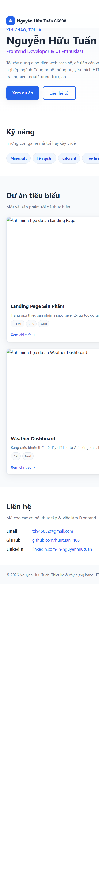
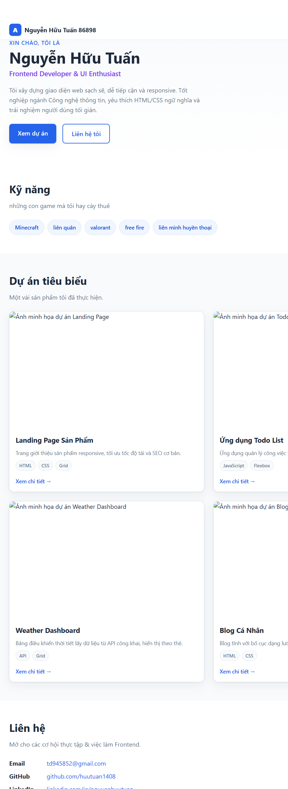
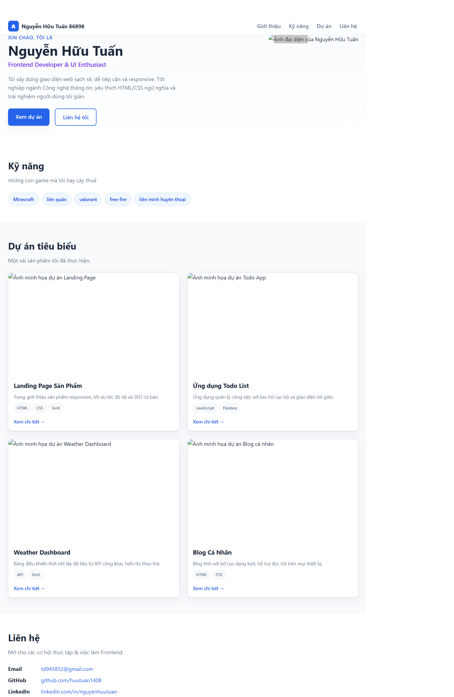

# Báo cáo kiểm thử trước bàn giao

## 1. Tiêu đề báo cáo & Thông tin chung

| Thông tin | Chi tiết |
|---|---|
| **Tên dự án** | Nguyễn Hữu Tuấn — Portfolio CV |
| **Phiên bản** | v1.0 |
| **Ngày kiểm thử** | 05/11/2026 |
| **Người thực hiện/đánh giá** | QA/QC — rà soát tĩnh repository; chưa ghi nhận người ký duyệt |
| **Phạm vi** | Đối chiếu mã nguồn HTML/CSS, tài liệu bàn giao và cấu trúc repository |
| **Phương pháp** | Rà soát tĩnh và kiểm tra hiển thị bằng trình duyệt tại viewport 390×844, 768×1024 và 1366×900; chưa kiểm thử trên thiết bị vật lý hoặc môi trường production |

### Quy ước trạng thái

- **Đạt:** Có đủ cơ sở xác nhận qua phạm vi kiểm tra đã thực hiện.
- **Chưa đạt:** Có lỗi hoặc thiếu sót cụ thể cần xử lý trước khi bàn giao.
- **Cần cải thiện:** Có cơ sở hoặc triển khai một phần, nhưng cần kiểm thử bổ sung hoặc hoàn thiện thêm.

> Kết quả trong báo cáo phản ánh rà soát tĩnh tại thời điểm ghi nhận, không thay thế biên bản kiểm thử runtime. Các tiêu chí chưa được chạy thực tế được đánh dấu **Cần cải thiện** hoặc **Chưa đạt**, không mặc định là đã đạt.

## 2. Bảng tổng quan trạng thái

| # | Nhóm tiêu chí | Trạng thái | Tóm tắt |
|---:|---|---|---|
| 1 | Tính đúng đắn và mức độ đáp ứng yêu cầu chức năng | **Chưa đạt** | Có đủ các khu vực nội dung chính, nhưng liên kết chi tiết dự án chưa hoạt động và nội dung một số mục chưa nhất quán với mục tiêu portfolio. |
| 2 | Giao diện, trải nghiệm người dùng và khả năng tương thích | **Cần cải thiện** | Đã chụp và kiểm tra giao diện ở ba viewport; lưới dự án đổi 1/2/3 cột đúng breakpoint, nhưng có 5 ảnh không tải được và chưa kiểm thử đa trình duyệt/thiết bị. |
| 3 | Khả năng vận hành, xử lý lỗi và hiệu năng cơ bản | **Cần cải thiện** | Có hướng dẫn chạy website tĩnh; chưa có kết quả chạy thử, đo hiệu năng hoặc kiểm tra xử lý lỗi runtime. |
| 4 | Bảo mật, quản lý cấu hình và dữ liệu | **Cần cải thiện** | Không thấy backend, biểu mẫu thu thập dữ liệu hay cấu hình bí mật; cần hoàn thiện thuộc tính an toàn cho liên kết mở tab mới và xác nhận triển khai. |
| 5 | Chất lượng mã nguồn, cấu trúc repository và tài liệu bàn giao | **Cần cải thiện** | Cấu trúc đơn giản và có tài liệu, nhưng đường dẫn ảnh cục bộ khiến nội dung không portable; cần rà soát tính nhất quán và hoàn thiện tài liệu. |
| 6 | Khả năng triển khai, kiểm thử và cung cấp minh chứng | **Cần cải thiện** | Đã có ảnh chụp responsive ở ba viewport; chưa kiểm thử quy trình triển khai, chưa có test tự động hoặc thông tin môi trường thực tế. |

## 3. Nội dung chi tiết từng tiêu chí

### 3.1. Tính đúng đắn và mức độ đáp ứng yêu cầu chức năng

| Hạng mục kiểm tra | Trạng thái | Ghi chú/Minh chứng |
|---|---|---|
| Có khu vực Giới thiệu, Kỹ năng, Dự án và Liên hệ | **Đạt** | Các section tương ứng có trong `index.html`; menu điều hướng trỏ tới các ID `#about`, `#skills`, `#projects`, `#contact`. |
| Các nút điều hướng chính trỏ tới đúng khu vực | **Đạt** | Liên kết nội bộ được khai báo trong menu và các nút ở phần giới thiệu. Chưa xác nhận bằng thao tác trên trình duyệt. |
| Liên kết email và hồ sơ mạng xã hội được khai báo | **Đạt** | Có `mailto:` và URL GitHub/LinkedIn trong phần Liên hệ. Chưa xác minh các đích liên kết có tồn tại hoặc thuộc đúng tài khoản. |
| Liên kết “Xem chi tiết” mở trang dự án tương ứng | **Chưa đạt** | Các thẻ dự án dùng `href="#"`, không dẫn tới chi tiết dự án. |
| Nội dung kỹ năng và dự án phù hợp với mục tiêu portfolio/CV | **Chưa đạt** | Mục Kỹ năng đang liệt kê tên trò chơi; mô tả dự án trình bày như sản phẩm nhưng chưa có URL/đích đến xác thực. Cần xác nhận và cập nhật nội dung thực tế trước bàn giao. |
| Ảnh đại diện và ảnh dự án tải được từ repository | **Chưa đạt** | Các thẻ ảnh trong `index.html` tham chiếu đường dẫn tuyệt đối `C:\Users\acer\Downloads\...`; các tệp này không nằm trong repository nên không portable. |

### 3.2. Giao diện, trải nghiệm người dùng và khả năng tương thích

| Hạng mục kiểm tra | Trạng thái | Ghi chú/Minh chứng |
|---|---|---|
| Có cấu trúc giao diện responsive theo nhiều kích thước | **Đạt** | Đã kiểm tra bằng trình duyệt tại 390×844, 768×1024 và 1366×900. Lưới dự án lần lượt hiển thị 1, 2 và 3 cột; `documentElement.scrollWidth` không vượt `innerWidth`. Ảnh chụp ở phần minh chứng bên dưới. |
| Thành phần điều hướng và bố cục có thể xuống dòng trên màn hình hẹp | **Cần cải thiện** | CSS có `flex-wrap` cho header, navigation và các nhóm nút; chưa xác nhận không tràn hoặc chồng lấn trên thiết bị thật. |
| Ảnh và tài nguyên hiển thị đúng trong bố cục | **Chưa đạt** | CSS đặt `max-width: 100%`, nhưng trong lần chụp responsive, 5 ảnh không tải được do tham chiếu tới đường dẫn cục bộ không khả dụng trong môi trường trình duyệt; cần đóng gói ảnh và chụp lại để xác nhận. |
| Hỗ trợ điều hướng bàn phím và trạng thái focus | **Đạt** | Có quy tắc `:focus-visible` thể hiện viền focus. Chưa thực hiện kiểm thử bàn phím end-to-end hoặc trình đọc màn hình. |
| Hạn chế chuyển động theo tùy chọn hệ điều hành | **Đạt** | CSS có `prefers-reduced-motion: reduce` để tắt transition/animation và cuộn mượt. Chưa kiểm tra trên trình duyệt. |
| Tương thích Chrome, Firefox, Edge, Safari và thiết bị di động | **Cần cải thiện** | README nêu trình duyệt mục tiêu, nhưng chưa có ma trận trình duyệt/thiết bị hoặc kết quả chạy thực tế. |

#### Minh chứng ảnh chụp responsive

Ảnh được chụp từ trang portfolio trong trình duyệt tại ba kích thước viewport. Các ảnh lỗi hiển thị trong ảnh chụp cũng được giữ nguyên làm minh chứng cho lỗi tài nguyên đã ghi nhận.

Mobile — 390×844

Tablet — 768×1024

Desktop — 1366×900

### 3.3. Khả năng vận hành, xử lý lỗi và hiệu năng cơ bản

| Hạng mục kiểm tra | Trạng thái | Ghi chú/Minh chứng |
|---|---|---|
| Có thể phục vụ dưới dạng website tĩnh theo hướng dẫn | **Cần cải thiện** | README hướng dẫn mở `index.html`, chạy Python HTTP server và Docker/Nginx; chưa thực thi các cách chạy để xác nhận. |
| Tài nguyên bắt buộc tải thành công khi triển khai | **Chưa đạt** | Các ảnh hiện dùng đường dẫn tuyệt đối trên máy cá nhân; cần thay bằng tài nguyên trong repository và kiểm tra phản hồi tải tài nguyên. |
| Có xử lý lỗi khi nội dung hoặc tài nguyên không sẵn sàng | **Cần cải thiện** | Không có backend hay logic runtime phức tạp được thấy trong phạm vi rà soát; chưa có cơ chế/thông báo dự phòng cho ảnh không tải được. |
| Hiệu năng tải trang cơ bản | **Cần cải thiện** | HTML/CSS thuần, không thấy framework hoặc thư viện JavaScript; chưa đo thời gian tải, kích thước tài nguyên, Core Web Vitals hoặc hiệu năng trên mạng chậm. |
| Kiểm tra lỗi console và lỗi HTTP | **Cần cải thiện** | Chưa chạy website trên trình duyệt hoặc máy chủ nên chưa thu thập console, network log hay mã phản hồi. |

### 3.4. Bảo mật, quản lý cấu hình và dữ liệu

| Hạng mục kiểm tra | Trạng thái | Ghi chú/Minh chứng |
|---|---|---|
| Không đưa thông tin bí mật/cấu hình môi trường vào mã nguồn | **Đạt** | README mô tả website không dùng tệp `.env`, backend hoặc cơ sở dữ liệu; rà soát tĩnh không ghi nhận cấu hình bí mật. |
| Không thu thập hoặc lưu dữ liệu người dùng ngoài phạm vi đã công bố | **Đạt** | Trang được mô tả là website tĩnh, không có biểu mẫu gửi dữ liệu hoặc backend trong phạm vi mã nguồn đã kiểm tra. |
| Liên kết ngoài mở tab mới có thuộc tính bảo vệ phù hợp | **Cần cải thiện** | Liên kết GitHub/LinkedIn dùng `target="_blank"` nhưng chưa khai báo `rel="noopener noreferrer"`. Bổ sung trước khi triển khai. |
| Nội dung liên hệ và liên kết công khai đúng chủ sở hữu | **Cần cải thiện** | Cần chủ dự án xác nhận email và tài khoản GitHub/LinkedIn trước khi phát hành; báo cáo không xác minh quyền sở hữu hoặc khả năng truy cập. |
| Kiểm tra bảo mật triển khai và cấu hình máy chủ | **Cần cải thiện** | Chưa có môi trường triển khai thực tế để rà soát HTTPS, header bảo mật, cấu hình máy chủ hoặc log. |

### 3.5. Chất lượng mã nguồn, cấu trúc repository và tài liệu bàn giao

| Hạng mục kiểm tra | Trạng thái | Ghi chú/Minh chứng |
|---|---|---|
| Cấu trúc repository rõ ràng, tách HTML/CSS và tài nguyên | **Đạt** | Có `index.html`, `assets/css/styles.css`, `assets/img/` và `docs/`; README mô tả cấu trúc dự án. |
| Sử dụng HTML ngữ nghĩa và metadata cơ bản | **Đạt** | Có `lang="vi"`, charset, viewport, description, title; sử dụng các phần tử như `header`, `nav`, `main`, `section`, `article`, `footer`. |
| Tài nguyên tham chiếu bằng đường dẫn tương đối trong repository | **Chưa đạt** | Các ảnh đại diện/dự án đang tham chiếu đường dẫn cục bộ Windows; sửa về đường dẫn tương đối tới tài nguyên được đóng gói. |
| Mã nguồn không có nội dung mẫu/lệch với mục đích sản phẩm | **Chưa đạt** | Nội dung kỹ năng và các dự án chưa được xác nhận là thông tin thực tế; cần được chủ dự án duyệt. |
| Tài liệu hướng dẫn cài đặt, chạy và tùy chỉnh | **Đạt** | README có hướng dẫn chạy trực tiếp, Python HTTP server, Docker và tùy chỉnh. |
| Release note và nhật ký thay đổi có sẵn | **Đạt** | Có `docs/RELEASENOTE.md` và `docs/AI_LOG.md`; cần cập nhật chúng khi phát sinh thay đổi mới. |

### 3.6. Khả năng triển khai, kiểm thử và cung cấp minh chứng

| Hạng mục kiểm tra | Trạng thái | Ghi chú/Minh chứng |
|---|---|---|
| Có hướng dẫn triển khai/chạy cục bộ | **Đạt** | README cung cấp lệnh Python HTTP server và Docker/Nginx. Các lệnh chưa được thực thi trong lần rà soát này. |
| Có thể triển khai từ nội dung trong repository mà không phụ thuộc máy cá nhân | **Chưa đạt** | Đường dẫn ảnh cục bộ khiến tài nguyên không được đóng gói đầy đủ và không portable. |
| Có bộ test hoặc checklist kiểm thử đã thực thi | **Cần cải thiện** | Đã kiểm tra responsive thủ công tại ba viewport bằng trình duyệt; chưa có bộ test tự động hoặc biên bản kiểm thử các chức năng khác. |
| Có minh chứng triển khai/thực thi để đối chiếu | **Cần cải thiện** | Có ảnh chụp responsive tại `docs/screenshots/`; chưa có URL môi trường triển khai, log máy chủ hoặc kết quả kiểm thử đa trình duyệt. |
| Có quy trình xác nhận và ký duyệt trước bàn giao | **Cần cải thiện** | Chưa có người đánh giá/ký duyệt cụ thể hoặc tiêu chí nghiệm thu được xác nhận. |

## 4. Đánh giá tổng kết & Đề xuất

### Nhận định chung

Sản phẩm có nền tảng là website portfolio tĩnh, cấu trúc nội dung và hướng dẫn chạy cơ bản đã có. Đã kiểm tra và lưu ảnh chụp responsive ở ba viewport, nhưng **chưa nên xác nhận sẵn sàng bàn giao**: 5 ảnh không tải được, liên kết chi tiết dự án chưa hoạt động và một phần nội dung cần được xác thực. Chưa có kiểm thử đa trình duyệt, trên thiết bị vật lý hoặc môi trường triển khai.

### Vấn đề cần xử lý trước bàn giao

1. Đưa ảnh cần thiết vào repository (ví dụ `assets/img/`) và cập nhật toàn bộ tham chiếu sang đường dẫn tương đối; kiểm tra ảnh tải thành công.
2. Thay `href="#"` của các liên kết dự án bằng đích đến hợp lệ hoặc bỏ/đổi nhãn liên kết nếu dự án chưa có trang chi tiết.
3. Xác nhận nội dung kỹ năng, dự án, ảnh và thông tin liên hệ với chủ dự án.
4. Thêm `rel="noopener noreferrer"` cho các liên kết ngoài dùng `target="_blank"`.
5. Sau khi sửa tài nguyên, chụp lại các viewport di động, máy tính bảng và desktop; kiểm tra điều hướng, console/network trên máy chủ cục bộ hoặc môi trường staging.
6. Ghi lại trình duyệt/thiết bị, kết quả kiểm thử và lỗi còn mở; chỉ ký duyệt sau khi các lỗi **Chưa đạt** được xử lý hoặc có chấp thuận ngoại lệ.

### Phạm vi chưa được xác minh

- Đã kiểm tra giao diện bằng trình duyệt tại ba kích thước viewport và lưu ảnh chụp; chưa kiểm thử đa trình duyệt/thiết bị vật lý, đo hiệu năng, quét bảo mật hoặc kiểm tra môi trường production.
- Các trạng thái cần được cập nhật sau khi chạy kiểm thử thực tế và lưu minh chứng.